# Active Directory Group Policy Lab — User Policy Management

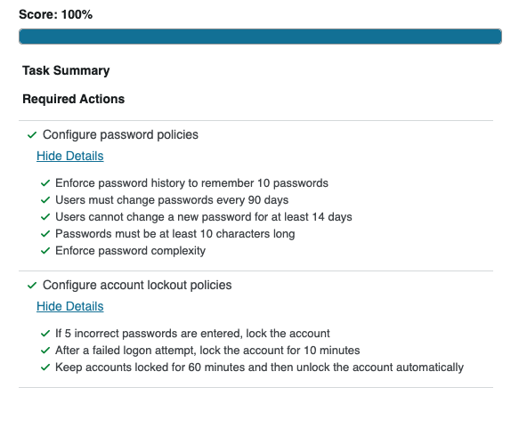

**CompTIA A+ Core 2 | Lab 19.1.9 | Completed November 23, 2026 | Score: 100%**

## Project summary

Configured and verified domain-wide password and account lockout policies using **Group Policy Management** on the **CorpDC** domain controller in a simulated Windows Server corporate environment. The lab used Hyper-V virtual machines and the **Default Domain Policy** for the `CorpNet.local` domain.

> This is a guided CompTIA training lab in a simulated corporate network, not a claim of a production deployment.

## Objectives and lab directives

The lab required editing **Default Domain Policy** to configure:

| Password policy | Required value |
| --- | --- |
| Enforce password history | Remember 10 passwords |
| Maximum password age | 90 days |
| Minimum password age | 14 days |
| Minimum password length | 10 characters |
| Passwords must meet complexity requirements | Enabled |

| Account lockout policy | Required value |
| --- | --- |
| Account lockout threshold | 5 invalid logon attempts |
| Account lockout duration | 60 minutes |
| Reset account lockout counter after | 10 minutes |

**Additional observed setting:** Store passwords using reversible encryption remained **Disabled**. This was not one of the eight scored tasks.

## Environment and tools

- CompTIA simulated corporate network, `CorpNet.local`
- Hyper-V Manager on `CorpServer`
- Virtual domain controller: `CorpDC`
- Windows Server Manager
- Group Policy Management (`gpmc.msc`)
- Group Policy Management Editor

## Step-by-step actions performed

### 1. Reviewed the lab scenario and success criteria

Read the lab instructions and eight required actions before making changes.

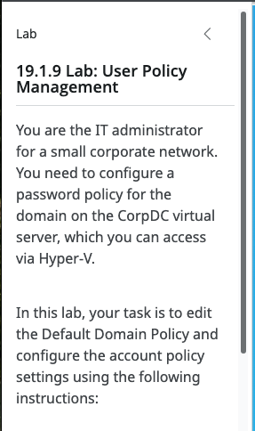
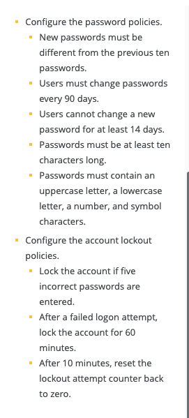
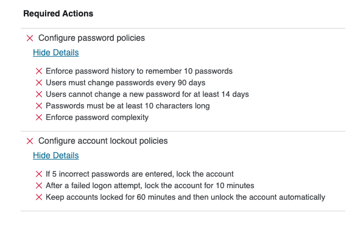

### 2. Identified the correct server

Initially examined Server Manager on `CorpServer`. **Group Policy Management was absent from the Tools menu**. Opened **Hyper-V Manager**, selected the running `CorpDC` virtual machine, and connected to it. On `CorpDC`, Server Manager displayed Active Directory tools, including Group Policy Management.

**Troubleshooting lesson:** Administrative consoles depend on which server is being managed and which roles/tools are installed. The lab required the domain controller VM, not the Hyper-V host.

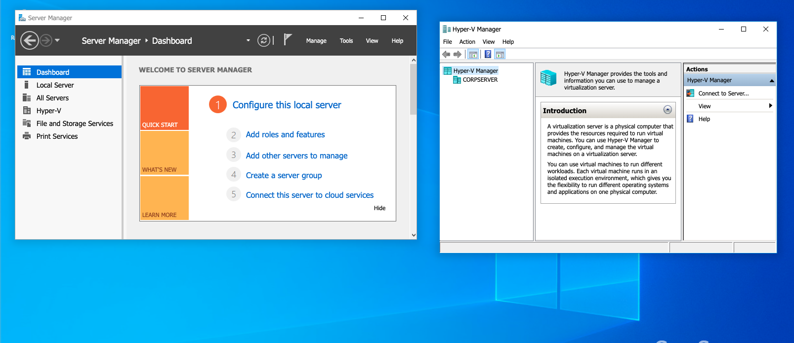
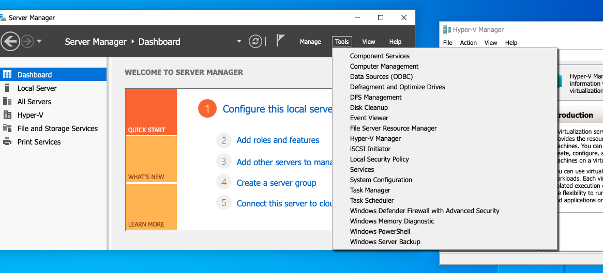
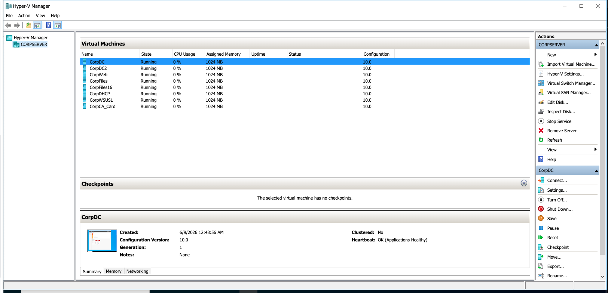
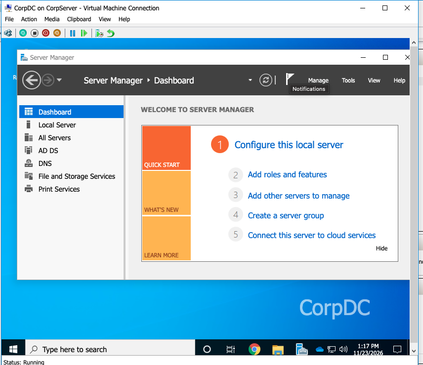
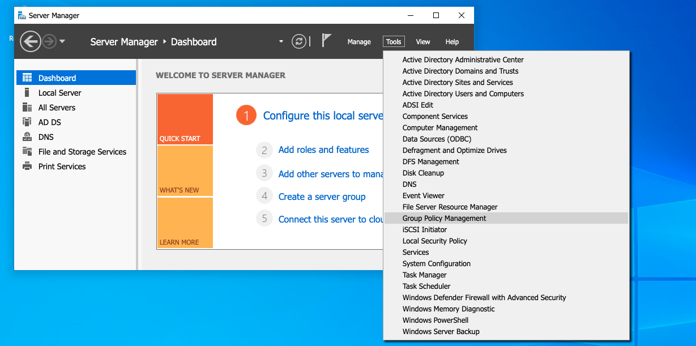

### 3. Opened and located Default Domain Policy

On `CorpDC`:

1. Opened **Server Manager > Tools > Group Policy Management**.
2. Expanded **Forest: CorpNet.local > Domains > CorpNet.local**.
3. Right-clicked **Default Domain Policy** and selected **Edit**.

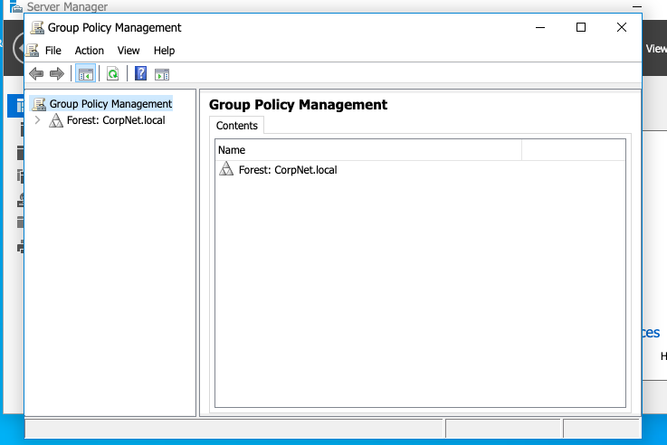
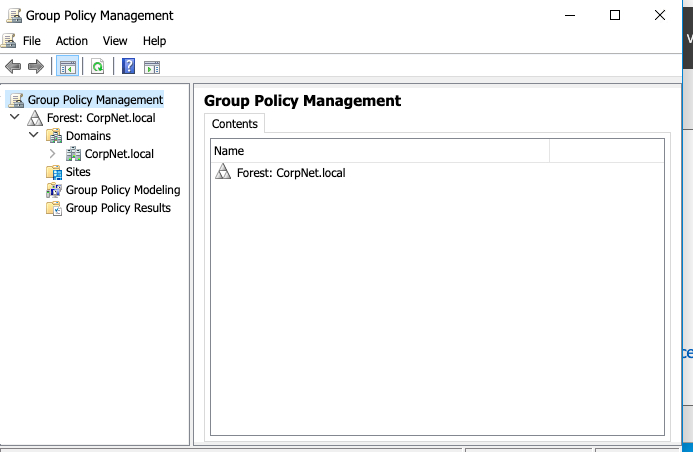
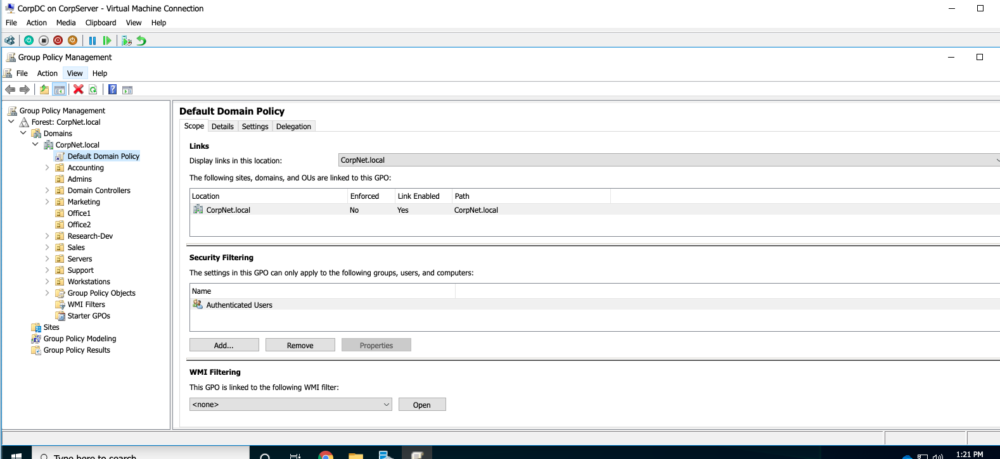
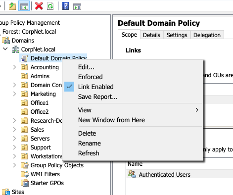
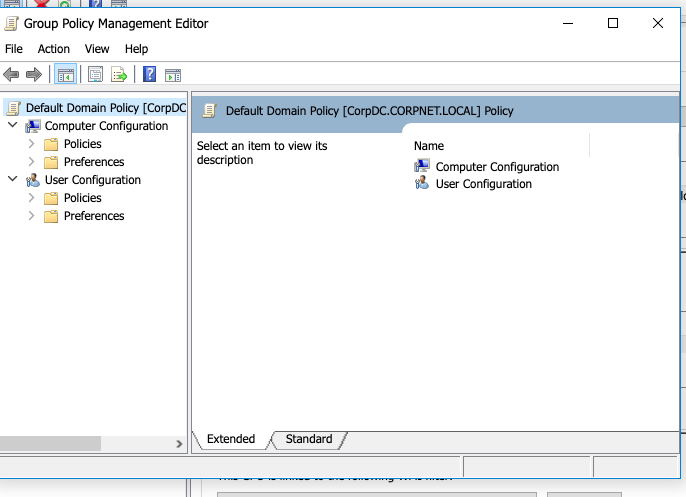

### 4. Navigated to password and account policies

In Group Policy Management Editor, expanded:

`Computer Configuration > Policies > Windows Settings > Security Settings > Account Policies`

Selected **Password Policy**. The initial screenshot showed default values such as a 24-password history, 42-day maximum age, 1-day minimum age, 7-character minimum length, and disabled complexity requirements.

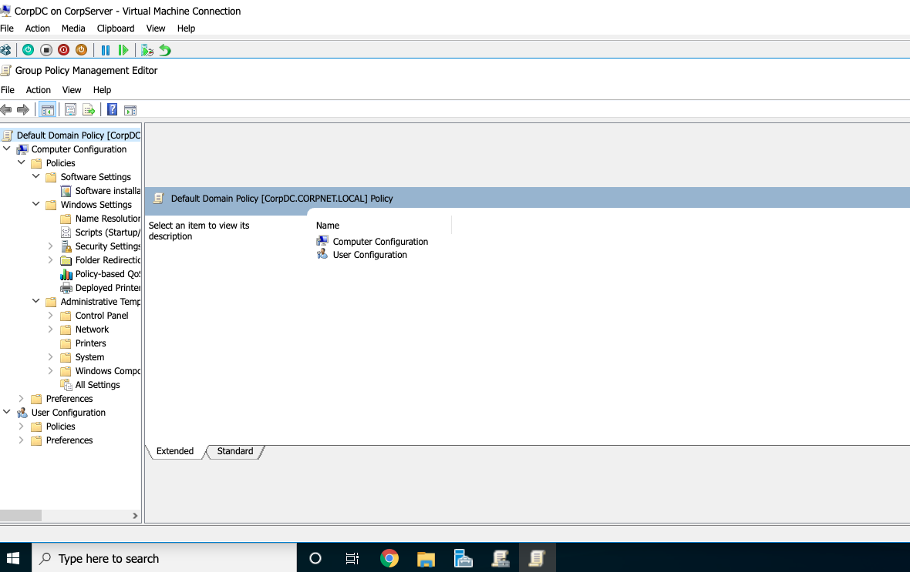
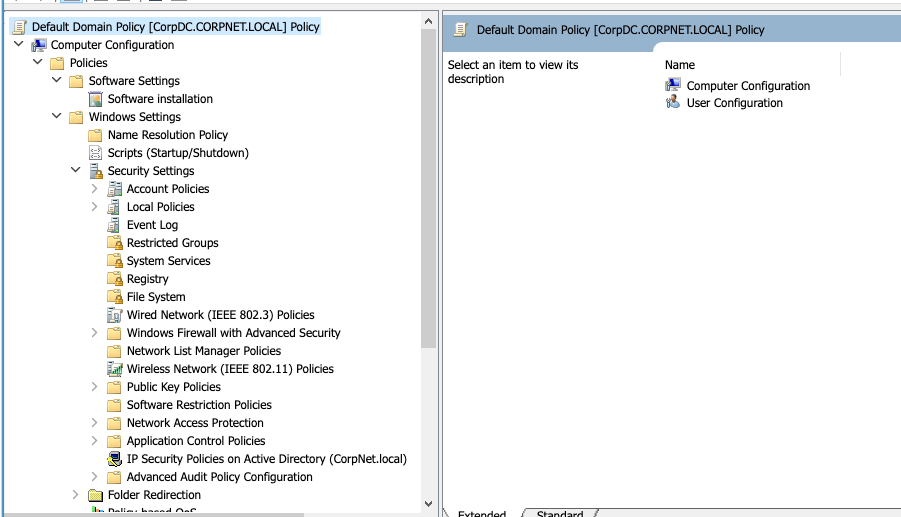
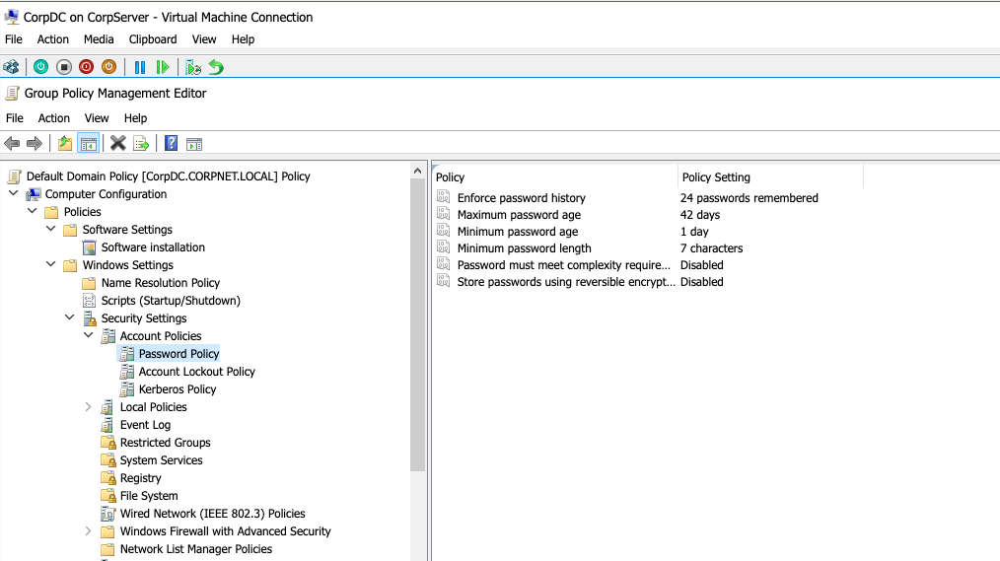

### 5. Configured password policies

Double-clicked each policy, entered the lab's required value, and saved the changes:

1. **Enforce password history:** 10 passwords remembered.
2. **Maximum password age:** 90 days.
3. **Minimum password age:** 14 days.
4. **Minimum password length:** 10 characters.
5. **Passwords must meet complexity requirements:** Enabled.

Verified that **Store passwords using reversible encryption** was **Disabled**.

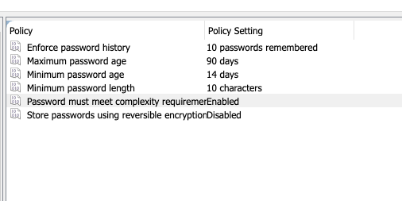

**Why it matters:** Password history prevents immediate reuse; length and complexity raise guessing difficulty; minimum and maximum age settings enforce the lab's password-change rules. In real environments, password expiration policies should follow current organizational guidance rather than be copied automatically from a training exercise.

### 6. Configured account lockout policies

Selected **Account Lockout Policy** under **Account Policies**. Initially the settings were not defined. Opened each policy and configured:

1. **Account lockout threshold:** 5 invalid logon attempts.
2. **Account lockout duration:** 60 minutes.
3. **Reset account lockout counter after:** 10 minutes.

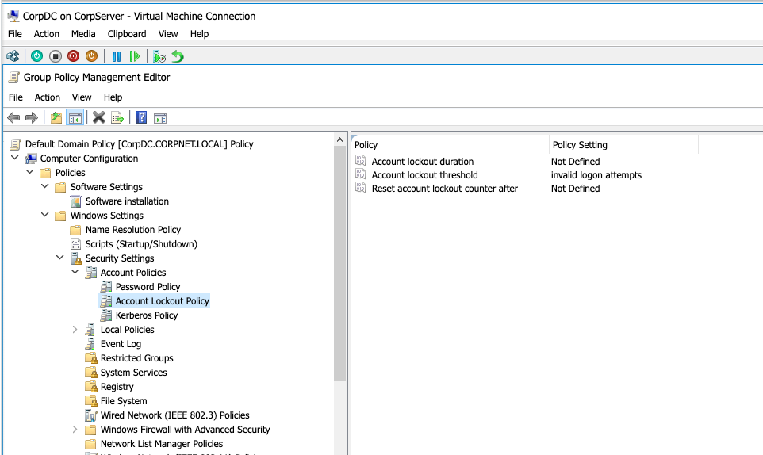
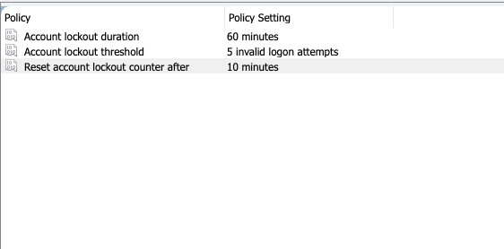

**Why it matters:** The threshold limits repeated password guesses, the duration determines how long a locked account stays locked, and the reset interval clears accumulated failed attempts after a period without further failures.

### 7. Verified the outcome

Returned to the CompTIA simulation and selected **Check Answers**. The result displayed **Score: 100%**, with green checkmarks for all **eight required actions**.

## Results

| Verification | Result |
| --- | --- |
| Password policy requirements | 5/5 passed |
| Account lockout requirements | 3/3 passed |
| Lab score | **100%** |
| Final state | **Completed** |

## Troubleshooting and lessons learned

- **Issue:** Group Policy Management was missing from the first Server Manager Tools menu. **Resolution:** Connected to the `CorpDC` VM through Hyper-V Manager and launched the tool there.
- **Issue:** The Group Policy Editor navigation required expanding several nested folders. **Resolution:** Followed the full Computer Configuration > Policies > Windows Settings > Security Settings > Account Policies path.
- **Verification:** Compared configured values with the required-action checklist and confirmed the lab score.

## Skills demonstrated

`Active Directory` · `Windows Server` · `Hyper-V` · `Group Policy Management` · `Default Domain Policy` · `Password Policy` · `Account Lockout Policy` · `Security Administration` · `IT Troubleshooting` · `CompTIA A+ Core 2`

## Screenshot gallery

All screenshots are in [`screenshots/`](screenshots/). The README displays the major milestones in chronological order. Additional screenshots capture the lab directions, server selection, navigation, and final verification.

## Notes

- The lab result screen confirms the required 10-minute **reset counter** and 60-minute **lockout duration**, even though its explanatory phrasing about the 10-minute setting is potentially confusing. The configured policy values are the authoritative evidence.
- Screenshots are from a training simulation; they do not represent changes to a real corporate domain.
- Do not apply these specific policy values to a production domain without authorization and an organization-specific security policy.
